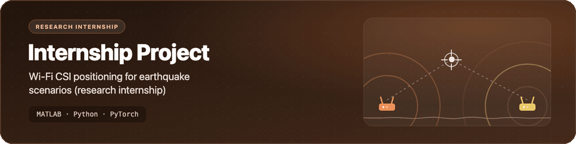
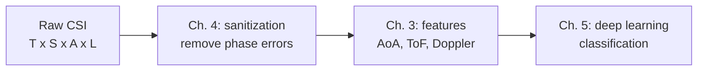

<p align="center">
  <picture>
    <source media="(prefers-reduced-motion: reduce) and (prefers-color-scheme: dark)" srcset="assets/banner-dark.svg">
    <source media="(prefers-reduced-motion: reduce)" srcset="assets/banner-light.svg">
    
  </picture>
</p>

<h1 align="center">InternshipProject</h1>

<p align="center">Study copy of the example code from <em>Hands-on Wireless Sensing with Wi-Fi: A Tutorial</em>, kept during a 2024 research internship in Taiwan on Wi-Fi CSI for wireless positioning in earthquake scenarios.</p>

<p align="center">
  
  
  
  
  
</p>

> [!NOTE]
> This code is not my own work. It is the companion code of the tutorial by Zheng Yang, Yi Zhang, Guoxuan Chi and Guidong Zhang (Tsinghua University). I kept a copy to study it during the internship. See [Credits](#credits).

## What's inside

- 📡 **Chapter 3, CSI features (MATLAB):** rough angle-of-arrival, time-of-flight (distance) and Doppler spectrum estimates from a sample CSI recording.
- 🧹 **Chapter 4, CSI sanitization (MATLAB):** calibration of nonlinear phase error, STO (SFO/PDD), CFO and RCO, with an angle-estimation and an intrusion-detection example before and after cleaning.
- 🧠 **Chapter 5, deep learning (Python):** a CNN + GRU classifier and a domain-adversarial variant (Keras) for Doppler spectrum data, and a complex-valued network trainer and test script (PyTorch).
- 💾 **Sample data:** the tutorial's small `.mat` test files for Chapters 3 and 4, so the MATLAB scripts run as they are.
- 📝 **Live script:** `main.mlx`, a MATLAB Live Script version of the Chapter 3 example.



## Getting started

```bash
git clone https://github.com/Worakornk/InternshipProject.git
cd InternshipProject
```

### MATLAB (Chapters 3 and 4)

Each `main.m` adds its own `functions/` folder to the path and reads `./data/`, so run it from inside its chapter folder. The scripts call `physconst`, which needs the Phased Array System Toolbox (or Antenna Toolbox).

```matlab
cd matlab/ch3-csi-features
main

cd ../ch4-csi-sanitization
main
```

<details>
<summary>Python (Chapter 5): what you need before it runs</summary>

These scripts are kept for reference and do not run out of the box:

- They read the Widar 3.0 dataset from absolute paths on the original authors' servers (`data_dir` in `CNN_RNN.py` and `Adversarial.py`, `file_path_csi` in `SEN_TEST.py`). Download the data from the [Widar 3.0 page](http://tns.thss.tsinghua.edu.cn/widar3.0/) and change those paths.
- `CNN_RNN.py` and `Adversarial.py` import `keras.backend.tensorflow_backend`, which only exists in standalone Keras 2.3 or earlier with TensorFlow 1.x.
- `SEN_trainer.py` imports `imp`, which was removed in Python 3.12, so use Python 3.11 or earlier.
- `SEN_TEST.py` loads a trained model from `./SEN_Results/`, which `SEN_trainer.py` writes.

```bash
cd python/ch5-deep-learning
python SEN_trainer.py
python SEN_TEST.py
```

</details>

## Project structure

```text
InternshipProject/
├── matlab/
│   ├── ch3-csi-features/
│   │   ├── main.m              # feature extraction example
│   │   ├── main.mlx            # Live Script version
│   │   ├── functions/          # naive_aoa, naive_tof, naive_spectrum
│   │   └── data/               # sample CSI (.mat)
│   └── ch4-csi-sanitization/
│       ├── main.m              # sanitization example
│       ├── functions/          # *_calib, set_template, naive_aoa, naive_intrusion
│       └── data/               # sample CSI and calibration data (.mat)
├── python/
│   └── ch5-deep-learning/
│       ├── CNN_RNN.py          # CNN + GRU (Keras)
│       ├── Adversarial.py      # domain-adversarial CNN + GRU (Keras)
│       ├── SEN_trainer.py      # complex-valued network training (PyTorch)
│       └── SEN_TEST.py         # test script for the trained model
├── .editorconfig
├── .gitignore
└── README.md
```

## Credits

- Code and sample data: Zheng Yang, Yi Zhang, Guoxuan Chi and Guidong Zhang, *Hands-on Wireless Sensing with Wi-Fi: A Tutorial*, [arXiv:2206.09532](https://arxiv.org/abs/2206.09532). Tutorial site and code download: [Guoxuan-Chi/Wireless-Sensing-Tutorial](https://github.com/Guoxuan-Chi/Wireless-Sensing-Tutorial).
- Dataset for Chapter 5: [Widar 3.0](http://tns.thss.tsinghua.edu.cn/widar3.0/), Tsinghua University.
- My changes: the folder names, this README, `main.mlx`, and a different copy of the Chapter 3 output file `data/csi_feature_test.mat` (the file `main.m` writes). The `.m` and `.py` files and the other `.mat` files are unchanged from the tutorial.

## License

The upstream tutorial does not publish a license, so this repository does not add one. All rights to the code and data stay with the original authors. Please cite their paper if you use it.
